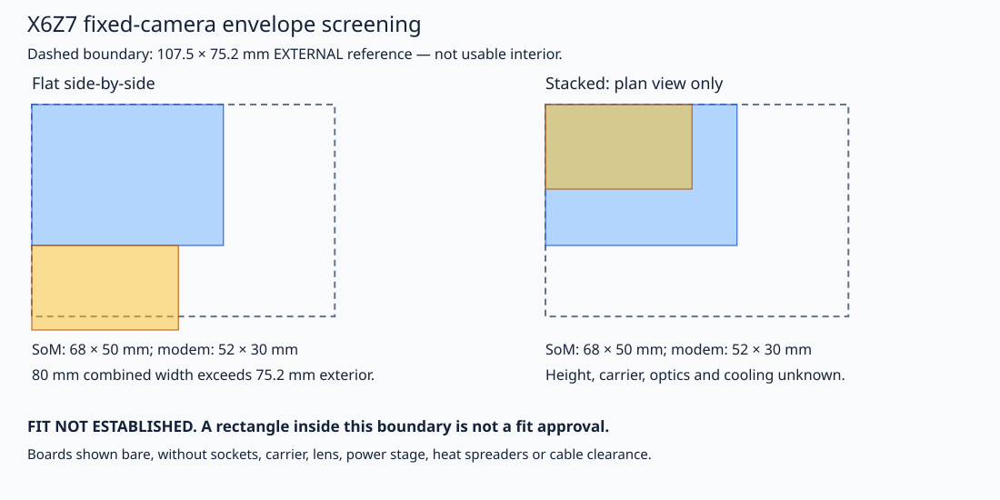

# X6Z7 fixed-camera fit check — 2026-09-24

**Result: fit is not established; do not release this housing for our complete
electronics stack.** Two simple flat layouts fail even an optimistic exterior
screen. A stacked layout remains possible, not proven. This is a dimensional
screen, not native Inventor assembly validation, interference analysis or FEA.

## Evidence and inputs

| Part | Published envelope/provision | What it does not establish |
| --- | --- | --- |
| Hasion X6Z7 | 107.5 mm body axial dimension; 75.2 mm front external width; 180.5 mm overall including mount | Internal cavity, height, taper, bosses, thermal surfaces |
| Hasion sensor mounting | Supports 38×38 / 42×42 mm sensor boards | Hole pattern or compute-board clearance |
| FRAMOS FSM-IMX585 | 26.5×26.5 mm board | Lens, holder, connector, adapter, assembled depth or Hasion mounting compatibility |
| Forlinx FET3588J-C candidate | 68×50 mm nominal module | Custom carrier, heat spreader, connector and service clearance |
| Quectel RM520N candidate | 52×30×2.3 mm module | Socket, fastener, antenna connectors/cables, thermal pad |
| Other electronics | Not selected/laid out | PoE isolated power, Ethernet magnetics, Wi-Fi/BT, MCU, USB-C PD cannot be treated as zero-volume |

Hasion catalog page 22 was visually checked. Its 74.6 mm dimension belongs to
the rear mount drawing, not a verified internal height. The 180.5 mm overall
length includes the mount and is not an electronics bay. Do not use the front
window callouts as internal board or lens clearances without supplier confirmation.

Sources:
- [Hasion exhibitor catalog, page 22](https://oemfile.informamarkets-info.com/FileUpload/2025SEC_39523/20250228212738965.pdf)
- [FRAMOS module](https://framos.com/products/modules/framos-sensor-modules/fsm-imx585-sensor-module-26378/)
- [Forlinx module brief](https://www.forlinx.net/download/FET3588-C-and-OK3588-C-product-brief.pdf)
- [Quectel module](https://www.quectel.com/product/5g-rm520n-series/)

## Necessary-condition calculations

Place the SoM's 68 mm edge along the body axis and its 50 mm edge across it.
With the modem's 52 mm edge axial:

- Side-by-side bare boards require 68×80 mm: width exceeds the 75.2 mm exterior
  by **4.8 mm**, even before any separation or wall thickness.
- End-to-end bare boards require 120×50 mm: length exceeds the 107.5 mm body
  reference by **12.5 mm**, before lens, connectors or walls.
- Stacking the boards requires at least 68×50 mm in plan, with **unknown total
  height**. Exterior residuals of 39.5 mm axial / 25.2 mm lateral are not internal
  clearances and are not allowances we can spend on other parts.
- Adding an explicitly assumed 3 mm perimeter gives a 74×56 mm screening
  rectangle. It is not a routed carrier outline or a supplier-approved keepout.

These failures apply only to the named orientations. Other placements, planes,
partial overlap or rotation were not exhaustively tested. The stack might fit
after design changes, but exterior dimensions cannot demonstrate that.

The 26.5 mm sensor PCB is smaller than the stated 38/42 mm board sizes; an adapter
may be possible. Screw locations, optical center, lens image circle, back focus,
IR-cut unit and lens/window clearance are all still open.

## Recommendation and closure

Ask Hasion to assess both a PoE/Wi-Fi base build and a cellular variant against
internal STEP/sections. Request their smallest suitable larger bullet housing
if X6Z7 cannot accept the assembled stack. A sealed electronics base is another
option, but moving the computer out of the head creates a camera-link design
problem: do not run raw MIPI over an arbitrary external cable.

Request usable cavity dimensions at multiple axial stations, board insertion
path, mounting/boss coordinates, maximum stack height, lens bay, thermal lands,
antenna access and USB-C plug/service clearance. Fit approval requires exact
component CAD, routed carrier envelope and cable/assembly checks. Thermal and
RF approval remain separate even after geometric fit passes.

Reproduce with `fixtures/mobius-venv/bin/python research/cctv-camera/check_fixed_fit.py`.
Numerical output: [fixed-fit-check.json](fixed-fit-check.json).
